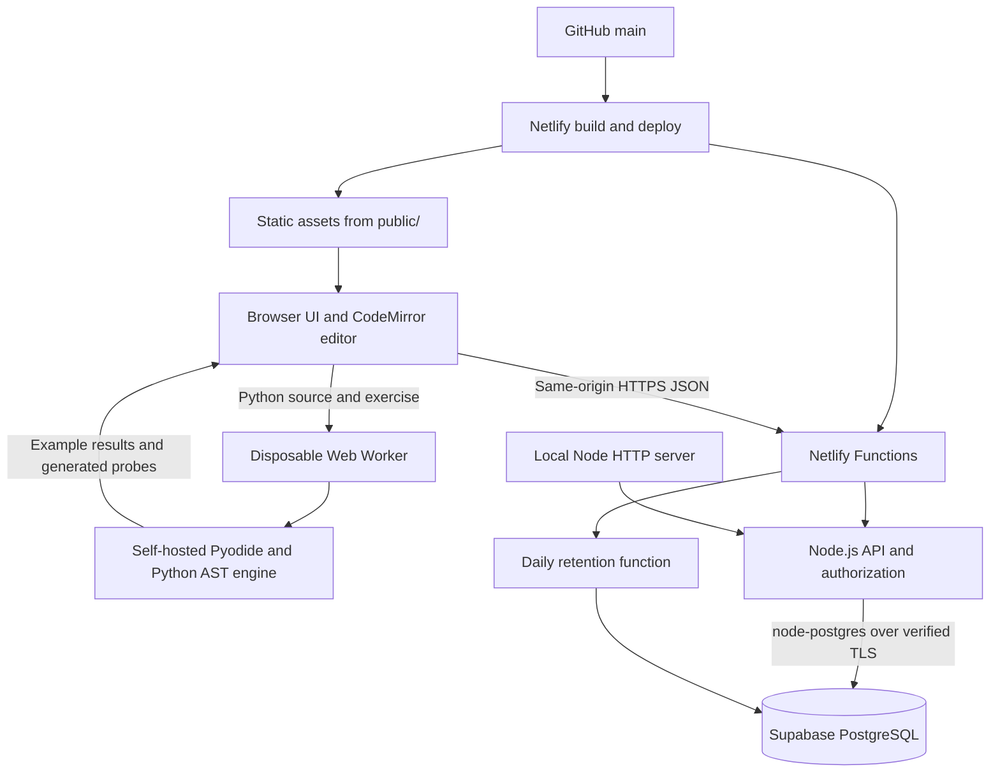

# Vouch Code Lab

Vouch turns a learner’s Python function into a code-reading exercise. Run the examples, compare a one-line change with the original, and predict the output or find an input that exposes the change. Instructors can assign a problem to a cohort and review its results. A public verification link confirms that Vouch recorded the round. It cannot establish authorship. [Exercise catalog](public/problems.json) · [Verification tests](tests/api.test.mjs)

[Live studio](https://vouch-code-lab.netlify.app/) · [Problem library](https://vouch-code-lab.netlify.app/#/library) · [Instructor desk](https://vouch-code-lab.netlify.app/#/instructor) · [Verify a record](https://vouch-code-lab.netlify.app/#/verify)

## Architecture



| Component | Responsibility and data boundary |
| --- | --- |
| Browser | Hash routes serve the library, practice editor, rounds, instructor desk and verification. CodeMirror 6 highlights Python. Drafts persist in local storage. Session storage lets the same tab resume a round. [App](public/app.js) · [Editor source](editor/codemirror.js) |
| Python runner | A worker loads the bundled Pyodide runtime, runs examples, mutates the Python AST, and returns computed questions. The browser enforces an execution deadline and terminates the worker. Learner source is processed on the device. [Worker lifecycle](public/engine-client.js) · [Engine](public/engine.py) · [Runtime test](tests/runtime-smoke.cjs) |
| Shared API | The browser submits a source fingerprint, problem ID, probe metadata and choices. The API authorizes instructor sessions and learner writes, scores submitted answers, and issues verification codes. Expected choices originate in the browser. The server does not independently execute the learner’s program. [Routes and privacy](docs/API.md) · [Integration tests](tests/api.test.mjs) |
| PostgreSQL | Instructors own cohorts. Attempts can belong to a cohort and have answer rows. Sessions, rate-limit windows, a signing key and short-lived revocation records support authentication and verification. Expired attempts and associated answers are purged by the scheduled function. [Schema](db/migrations/) · [Retention](netlify/functions/retention.mjs) |
| Deployment | Netlify publishes the contents of `public/`, routes `/api/*` to a function and serves the verification page at `/v/:code`. The local Node server serves the same app and API. GitHub Actions runs the browser matrix on isolated databases. [Hosting config](netlify.toml) · [Local entry point](server/start.mjs) · [CI](.github/workflows/browser.yml) |

## Set up a local copy

Install Node.js 22 and npm. Use Python 3.11+ for the engine tests and a running PostgreSQL 16 instance for instructor accounts, cohort boards and public records. The repository is private, so the clone command requires a GitHub account with access. No browser plugin or client API key is required.

```sh
git clone https://github.com/tulasiram2005/vouch-code-lab.git
cd vouch-code-lab
npm ci
npm start
```

Open [the local studio](http://127.0.0.1:4173). This starts browser practice. With no database configured, the shared features report unavailable. Stop the server with Ctrl+C before restarting with database access.

### Enable shared records

The following commands assume your local PostgreSQL role can create databases and authenticate on loopback. Run `createdb` once for each database. If your installation requires a password, configure your PostgreSQL client credentials privately. Keep production credentials out of the development shell.

```sh
createdb vouch_dev
createdb vouch_test
export DATABASE_URL='postgresql://127.0.0.1/vouch_dev'
export TEST_DATABASE_URL='postgresql://127.0.0.1/vouch_test'
npm run db:migrate
npm start
```

In a second terminal, run `curl -fsS http://127.0.0.1:4173/api/readyz`. Expect `{"status":"ready"}`. A 503 means shared storage is unavailable. Check the connection, migrations and access to the signing-key table. Environment variables apply to the shell where they were exported. The server reads the process environment directly. [Database setup](server/db.mjs) · [Migration runner](server/migrate.mjs)

### Work on the project

| To change | Start here | Check |
| --- | --- | --- |
| Exercise inputs, expected outputs or question generation | [Catalog](public/problems.json), [engine](public/engine.py) | Python tests and the bundled runtime smoke test |
| Learner, instructor or verification UI | [Browser app](public/app.js), [styles](public/style.css), [editor styles](public/editor-round.css) | Exercise the affected route locally and run the browser matrix |
| Persistence or API behavior | [API](server/api.mjs), [security helpers](server/security.mjs), [migrations](db/migrations/) | Add a migration for schema changes, migrate the dev database, and run integration tests with a disposable test database |
| Hosting and scheduled cleanup | [Netlify configuration](netlify.toml), [functions](netlify/functions/) | Check the deploy preview, production readiness and scheduled-function logs |

The browser serves a checked-in CodeMirror bundle. If you edit `editor/codemirror.js`, rebuild it from the installed lockfile dependencies with esbuild 0.28.1. This is an editor-maintenance tool, optional for running Vouch.

```sh
npx --yes --package=esbuild@0.28.1 esbuild editor/codemirror.js --bundle --minify --format=esm --outfile=public/codemirror.js
```

Review the source and bundle together and update the [license notices](public/codemirror-LICENSES.txt) when bundled dependencies change.

## Run the tests

Run these from the repository root. Export the test connection in this shell to include the PostgreSQL integration case. Without it, that case is skipped.

```sh
export TEST_DATABASE_URL='postgresql://127.0.0.1/vouch_test'
npm test
node tests/runtime-smoke.cjs
python3 tests/evaluate.py
npm audit
```

For the complete browser suite, open **Actions → Browser and accessibility → Run workflow**, select your branch, and start the run. Each job starts a fresh PostgreSQL service and an HTTPS loopback server, installs Chromium, and runs the learner, instructor and reviewer journeys with axe. The six combinations are 360, 768 and 1440 pixels in light and dark themes. The workflow includes the exact local server, TLS and browser commands for reproducing a single job. [Workflow](.github/workflows/browser.yml) · [Browser assertions](tests/browser.mjs) · [Measured results](docs/EVIDENCE.md)

## Test the live deployment

**Read-only smoke check.** Run `npm run test:live` from a clone with Node 22. It checks homepage delivery, HTTPS security headers, API health, database readiness, refusal of anonymous cohort access (HTTP 401), and delivery of the sample verification page. It creates no records and needs no credentials. [Check source](tests/live.mjs)

**Browser walkthrough.**

1. Open the library and choose **Count the positives**. Run the starter tests. Edit the return value to produce a wrong result, run again and inspect the expected and returned values. Restore the starter and rerun until every example passes. [Library](https://vouch-code-lab.netlify.app/#/library)
2. Start a round, compare the two lines, select with A–D or 1–4, and choose **Check answer**. After the last question, review the score and explanations. A shared round writes a production attempt. Use a practice nickname and leave the public name private unless you intend to share it.
3. Open the completed record and paste its verification link into the verifier. Check the outcome and use print preview to inspect the record, code and URL. For a read-only demonstration, open the sample directly. [Verifier](https://vouch-code-lab.netlify.app/#/verify) · [Sample](https://vouch-code-lab.netlify.app/v/VCH-SAMPLE)
4. To test the instructor flow, use a cohort you own. Open its join link in a separate browser profile, finish a round, then refresh the board and check the problem title and result. Use the local or CI database for repeatable testing, code regeneration and deletion. [Instructor desk](https://vouch-code-lab.netlify.app/#/instructor)

## Deployment and operations

Push reviewed changes to `main` to trigger the connected Netlify build. For a schema change, apply compatible migrations with a migration role before deploying dependent code. Set the runtime `DATABASE_URL` in Netlify’s production function environment. The app role needs access to the private application schema. Keep migration privileges and production records separate from previews and CI. [Deploy settings](netlify.toml) · [API operations](docs/API.md)

| When | Operator checks |
| --- | --- |
| After each release | Run `npm run test:live`, open the sample certificate, inspect Netlify function errors and confirm the deployed commit. Review API 401, 429 and 503 trends. Keep passwords, tokens, connection strings, public-record URLs and learner data out of logs and tickets. |
| After an access or configuration change | Review GitHub, Netlify and Supabase collaborators, require MFA for maintainers, and verify the production connection is absent from deploy previews. Remove unused tokens and restrict deploy and database credentials to the smallest required scope. [GitHub MFA](https://docs.github.com/en/authentication/securing-your-account-with-two-factor-authentication-2fa/about-two-factor-authentication) · [Netlify environment controls](https://docs.netlify.com/build/environment-variables/overview/) |
| Regular maintenance | Review dependency advisories, including the separately bundled Pyodide runtime. Check free-tier usage and the daily retention function. Keep encrypted database backups outside Git and rehearse restoring into an isolated database. Access to the signing-key table is sensitive. [Backup guidance](https://supabase.com/docs/guides/platform/backups) · [Free-tier notes](docs/FREE_TIER_LIMITS.md) |
| Suspected disclosure | Revoke or rotate the affected credential with its issuer, update the production function environment, redeploy and rerun readiness. Review provider access logs and invalidate affected sessions. Plan signing-key recovery separately because changing it affects existing records. |

[Release status](docs/STATUS.md) · [Verification evidence](docs/EVIDENCE.md) · [Remaining work](docs/REMAINING_WORK.md) · [Design references and licenses](docs/design/REFERENCES.md)
