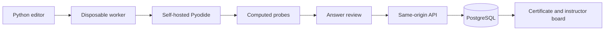

# Vouch

Vouch turns a learner’s Python function into a short code-reading exercise. Run the examples, examine a one-line mutation and predict its result or find an input that exposes the change. Each answer has an executable explanation.

## Try it

Open the library and select **Count the positives**. Run the supplied example, then start a round. For a second attempt, change the implementation while preserving its behavior. The next round is generated from the edited function.

## Run locally

Use Node 22+, Python 3.11+ for engine tests, and PostgreSQL for shared records.

```sh
npm ci
npm start
```

Open http://127.0.0.1:4173. For shared records, provide a private server-side DATABASE_URL and run `npm run db:migrate` before starting. Keep connection details out of Git. Netlify Functions use the same server-only variable.

## How a round works



Python source stays on the learner’s device. The browser sends the problem ID, a source fingerprint and choice information when it creates a shared record. A verification link reports the recorded result. The browser controls question generation, so the result is suitable for practice and instructor discussion. It cannot establish authorship.

## Project guide

- [Release status](docs/STATUS.md) and [open work](docs/REMAINING_WORK.md)
- [API, database operations and privacy](docs/API.md)
- [Verification evidence](docs/EVIDENCE.md)
- [Design references and licenses](docs/design/REFERENCES.md)

Codex generated the implementation and exercised the flows recorded in the evidence log. Human classroom evaluation is still open.
